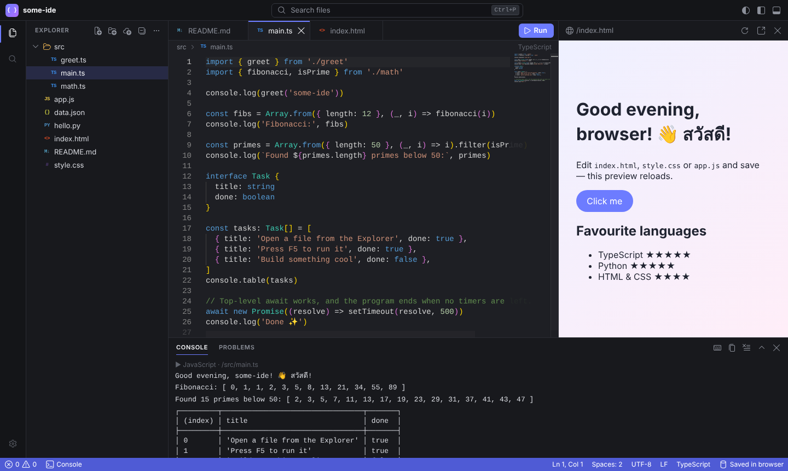

# some-ide

IDE ที่ทำงานบนเบราว์เซอร์ทั้งหมด — ไม่ต้องมี backend ไฟล์ทั้งหมดเก็บไว้ในเบราว์เซอร์ (IndexedDB)
และรันโค้ด TypeScript / JavaScript / Python / HTML ได้ทันที

_A browser-based IDE: Monaco editor (the editor behind VS Code), a file explorer, a console,
and runners for TypeScript, JavaScript, Python and HTML — all client-side, deployable as static files._



## ฟีเจอร์ (Features)

| | |
| --- | --- |
| **Editor** | Monaco: syntax highlighting ~80 ภาษา, IntelliSense + type checking สำหรับ TS/JS (รู้จัก import ข้ามไฟล์), format, multi-cursor, minimap, sticky scroll |
| **Files** | Explorer แบบ tree: สร้าง / rename (F2) / ลบ / ลากย้ายไฟล์, อัปโหลดไฟล์ โฟลเดอร์ หรือ `.zip`, ดาวน์โหลดทั้งโปรเจกต์เป็น `.zip` |
| **Run** | กด **F5** — TS/JS รันใน Web Worker (รองรับ `import` ไฟล์ในโปรเจกต์ และแพ็กเกจ npm ผ่าน [esm.sh](https://esm.sh)), Python รันด้วย [Pyodide](https://pyodide.org) (WebAssembly), HTML เปิด live preview ที่ reload เมื่อ save |
| **Console** | `console.log/table/time/group…` แสดงผลแบบ Node, stack trace / traceback คลิกแล้วกระโดดไปบรรทัดนั้น, ช่อง **Input** สำหรับ `input()` / `prompt()` |
| **Navigation** | Quick Open (Ctrl+P), Command Palette (Ctrl+Shift+P), Go to Line (Ctrl+G), ค้นหา/แทนที่ทุกไฟล์ (Ctrl+Shift+F), Problems panel |
| **Workspace** | จำไฟล์ แท็บ และ layout หลัง reload, การแก้ไขที่ยังไม่ save ก็ไม่หาย (hot exit), ธีมมืด/สว่าง, ใช้บนมือถือได้ |

## เริ่มต้นใช้งาน (Getting started)

ต้องใช้ Node.js 20.19+ หรือ 22.12+

```bash
npm install
npm run dev        # เปิด http://localhost:5173
```

Build เป็นไฟล์ static (โฟลเดอร์ `dist/`) แล้วนำไปวางบน host ไหนก็ได้ เช่น GitHub Pages, Netlify, Cloudflare Pages:

```bash
npm run build
npm run preview    # ทดสอบไฟล์ที่ build แล้ว
```

`base` ใน `vite.config.ts` ตั้งเป็น `./` ไว้แล้ว จึงวางใน sub-path (เช่น `https://user.github.io/some-ide/`) ได้เลย

## คีย์ลัด (Keyboard shortcuts)

บน macOS ใช้ ⌘ แทน Ctrl

| คำสั่ง | คีย์ |
| --- | --- |
| Run file / Stop | F5 / Shift+F5 |
| Go to file / Command palette | Ctrl+P / Ctrl+Shift+P (หรือ F1) |
| Go to line | Ctrl+G (หรือพิมพ์ `:` ใน Quick Open) |
| Save / Save all | Ctrl+S / Ctrl+Alt+S |
| New file / Close editor | Alt+N / Alt+W |
| Search in files | Ctrl+Shift+F |
| Toggle sidebar / panel | Ctrl+B / Ctrl+J |
| Show problems | Ctrl+Shift+M |
| Format document | Shift+Alt+F |
| Font size | Ctrl+= / Ctrl+- / Ctrl+0 |

ดูทั้งหมดได้จาก Settings (ไอคอนฟันเฟือง) → **Keyboard Shortcuts**

## การรันโค้ดทำงานอย่างไร (How running works)

- **TypeScript / JavaScript** — แต่ละครั้งที่รันจะสร้าง module worker ใหม่ ไฟล์ถูกแปลงด้วย
  [sucrase](https://github.com/alangpierce/sucrase) (ลบ type, แปลง JSX), import ถูก resolve
  ด้วย [es-module-lexer](https://github.com/guybedford/es-module-lexer) เป็น `blob:` URL
  ส่วน import แบบ bare (`'lodash'`) ชี้ไปที่ `https://esm.sh/lodash`
  โปรแกรม "จบ" เมื่อ module หลักรันเสร็จและไม่มี timer / fetch ค้างอยู่ (เหมือน Node)
- **Python** — โหลด Pyodide จาก jsDelivr ครั้งแรก (~10 MB, ต้องต่อเน็ต) แล้วใช้ซ้ำ
  ไฟล์ทั้งโปรเจกต์ถูก copy เข้าไปที่ `/project` จึง `import` โมดูลอื่นและ `open()` ไฟล์ได้
  แพ็กเกจอย่าง `numpy` โหลดให้อัตโนมัติจาก import
  เปลี่ยน URL ได้ด้วย `VITE_PYODIDE_URL` ตอน build
- **HTML** — สร้างเอกสารเดียวที่ inline CSS / script, ES modules ถูกเชื่อมด้วย import map ของ
  `data:` URL และรันใน iframe แบบ sandbox, `fetch('./data.json')` อ่านไฟล์ในโปรเจกต์ได้,
  ลิงก์ไปหน้า `.html` อื่นในโปรเจกต์ก็ทำงาน

## โครงสร้างโค้ด (Project structure)

repo นี้เป็น npm workspaces monorepo แอปเว็บตัวนี้คือรุ่น **Classic** ส่วน logic ที่ไม่ขึ้นกับ UI แยกเป็นแพ็กเกจ
เพื่อให้รุ่น desktop และมือถือในแผน ([docs/PLAN.md](docs/PLAN.md)) ใช้ร่วมกันได้

```
apps/classic/                 แอปเว็บ (Vite + Monaco)
  src/core/                   storage (IndexedDB), settings
  src/editor/                 ตั้งค่า Monaco, DocumentManager (model ต่อไฟล์ + dirty state), EditorArea (แท็บ)
  src/ui/                     explorer, search, console, problems, preview, quick input, dialogs
  src/workbench.ts            ประกอบทุกส่วน: layout, คำสั่ง, คีย์ลัด, การบันทึก
apps/mobile-spike/            P0 spike: CodeMirror 6 เป็น editor มือถือ (ตัดคำไทย, extra keys, checklist สำหรับทดสอบบนเครื่องจริง)
packages/runtime-core/        @some/runtime-core — ไม่มี DOM framework, ใช้ได้ทั้งเว็บ, desktop และมือถือ
  src/core/                   ระบบไฟล์เสมือน (vfs), path, search, fuzzy, zip, languages
  src/runner/                 module linker, JS worker, Python worker, HTML preview builder, console formatter
  tests/                      unit tests (Vitest)
packages/somed/               ต้นแบบ daemon บนเครื่องผู้ใช้: PTY + blocks (OSC 633) + WebSocket/TLS + จับคู่อุปกรณ์ (ดู README ในแพ็กเกจ)
e2e/                          end-to-end tests (Playwright) ของแอป Classic
docs/PLAN.md                  แผนสถาปัตยกรรมและ roadmap ของรุ่น desktop/มือถือ
docs/spikes/                  ผลการพิสูจน์ความเสี่ยง (P0 spikes)
```

## ทดสอบ (Tests)

```bash
npm run typecheck
npm test               # unit tests
npx playwright install chromium   # ครั้งแรกครั้งเดียว
npm run test:e2e       # build + เปิดในเบราว์เซอร์จริง (desktop + มือถือ)
```

## ข้อจำกัด (Limitations)

- เก็บได้เฉพาะไฟล์ข้อความ (ไฟล์ binary เช่นรูป PNG จะถูกข้ามตอนอัปโหลด; SVG ใช้ได้)
- ไม่มี terminal จริงและรัน Node API (`fs`, `http`) ไม่ได้ — โค้ดรันในเบราว์เซอร์
- `input()` / `prompt()` อ่านจากช่อง Input ที่กรอกไว้ก่อนรัน (ยังไม่ใช่แบบ interactive)
- Circular import ระหว่างไฟล์ยังไม่รองรับ
- Type ของแพ็กเกจ npm ไม่ถูกโหลด จึงไม่มี IntelliSense สำหรับแพ็กเกจเหล่านั้น
- ไฟล์เก็บใน browser profile นี้เท่านั้น — สำรองด้วย **Download Project as .zip**
